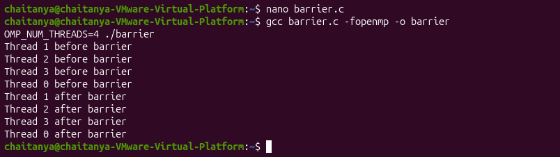
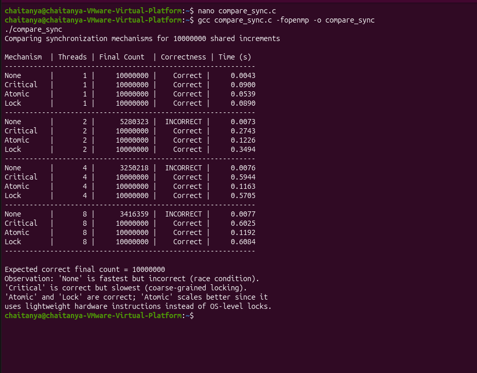
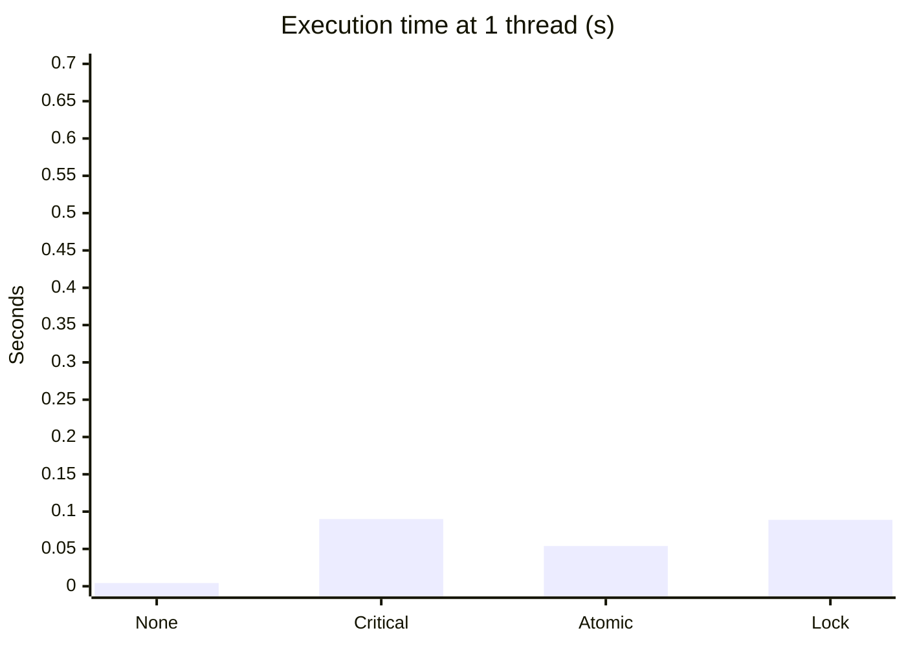
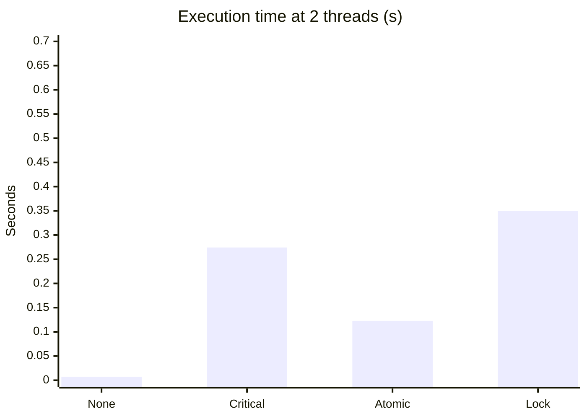
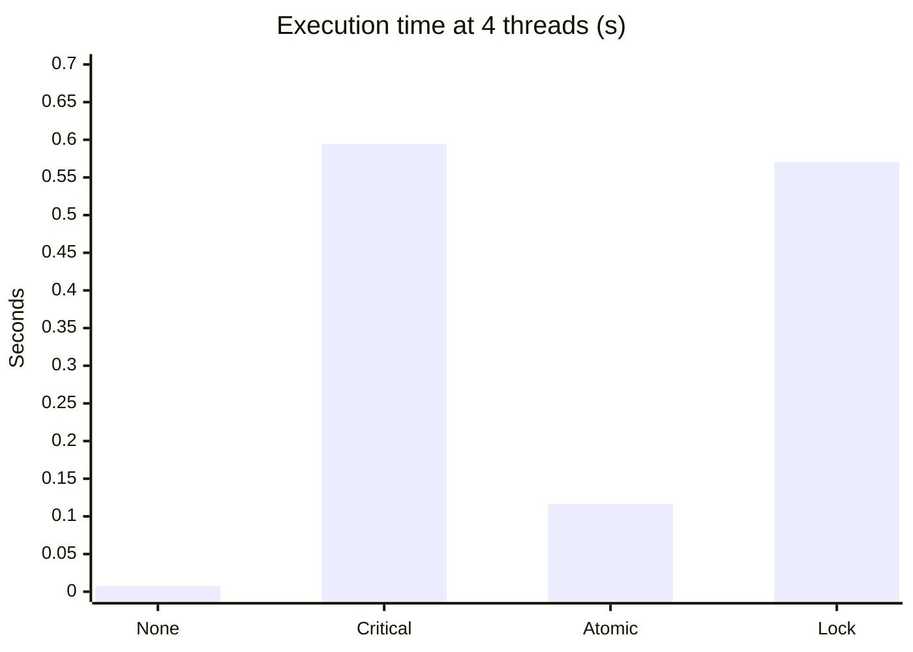
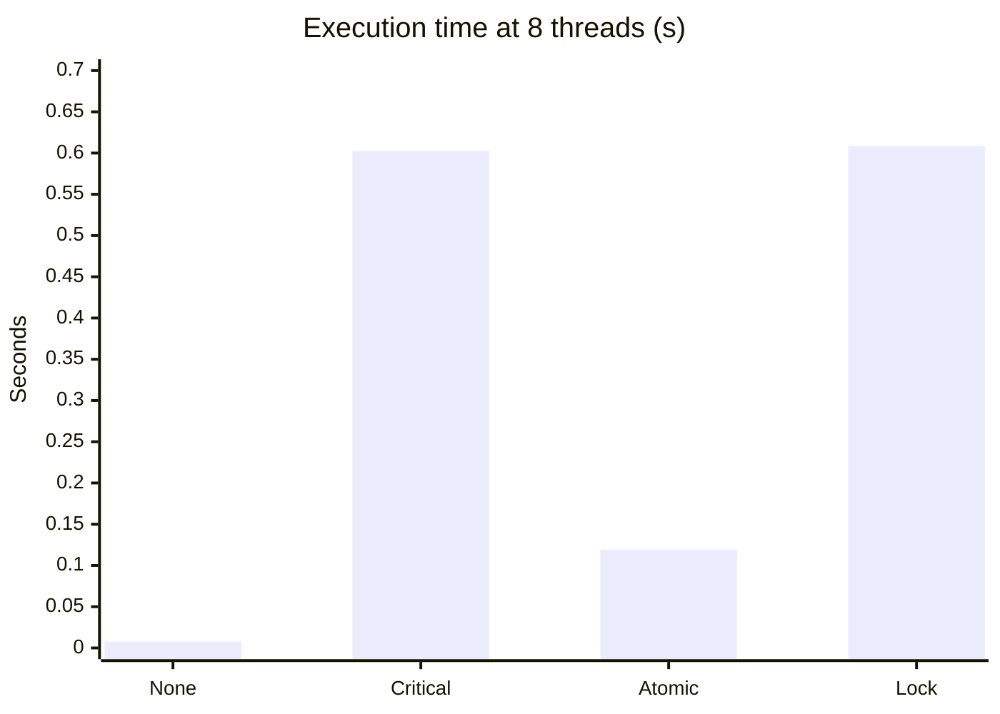
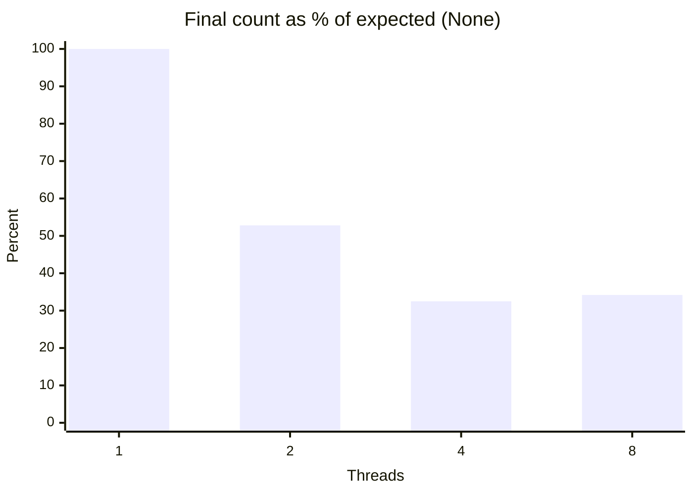

# Analyzing Synchronization Mechanisms in Parallel Programs

A hands-on study of common synchronization mechanisms in shared-memory parallel programs, written in C with **OpenMP** and **POSIX threads**. Each mechanism protects a shared counter, and the results are compared on **correctness**, **execution time** and **scalability** as the number of threads grows.

## Table of Contents
- [Objective](#objective)
- [Mechanisms Covered](#mechanisms-covered)
- [Environment](#environment)
- [Repository Structure](#repository-structure)
- [Build and Run](#build-and-run)
- [Programs and Output](#programs-and-output)
- [Benchmark: Comparing All Mechanisms](#benchmark-comparing-all-mechanisms)
- [Comparison Graphs](#comparison-graphs)
- [Observations](#observations)
- [Conclusion](#conclusion)

## Objective
To implement and study an unsynchronized (race) update, critical sections, atomic operations, barriers and semaphores/locks, and to evaluate how each behaves in terms of correctness, speed and scalability.

## Mechanisms Covered

| Mechanism | Directive / API | Idea |
|---|---|---|
| Race condition (none) | `#pragma omp parallel for` | No protection; concurrent `counter++` loses updates |
| Critical section | `#pragma omp critical` | Only one thread in the block at a time |
| Atomic operation | `#pragma omp atomic` | Indivisible hardware-level read-modify-write |
| Barrier | `#pragma omp barrier` | All threads must arrive before any proceeds |
| Semaphore | `sem_wait()` / `sem_post()` | Counter-based OS-level synchronization (binary semaphore used as a mutex) |
| Lock | `omp_set_lock()` / `omp_unset_lock()` | Explicit OpenMP mutex lock (used in the benchmark) |

## Environment

| Item | Details |
|---|---|
| Host virtualization | VMware Workstation Pro |
| Guest OS | Ubuntu 22.04 LTS |
| Compiler | GCC (`build-essential`) |
| Parallel libraries | OpenMP (`libgomp`), POSIX Threads (`pthread`) |

Install the toolchain:

```bash
sudo apt update
sudo apt install build-essential -y
gcc --version
echo '#include <omp.h>' | gcc -E -fopenmp -xc - > /dev/null && echo OpenMP OK
```

## Repository Structure

```
.
├── src/             # C source files
├── screenshots/     # Terminal output screenshots
├── Makefile
├── .gitignore
└── README.md
```

## Build and Run

Compile each program (adjust paths if your files are named differently):

```bash
gcc src/race.c         -fopenmp -o race
gcc src/critical.c     -fopenmp -o critical
gcc src/atomic.c       -fopenmp -o atomic
gcc src/barrier.c      -fopenmp -o barrier
gcc src/semaphore.c    -pthread -o semaphore
gcc src/compare_sync.c -fopenmp -o compare_sync
```

Run with a chosen thread count:

```bash
OMP_NUM_THREADS=4 ./atomic
# or
export OMP_NUM_THREADS=8
./critical
```

Run the full benchmark (1, 2, 4 and 8 threads):

```bash
./compare_sync
```

## Programs and Output

### 1. Race Condition (no synchronization)
Threads increment a shared counter with no protection. `counter++` is a read, an increment and a write, so updates get overwritten. The expected value is `10000000`, but the result is far lower and changes from run to run.

```c
#pragma omp parallel for
for (long i = 0; i < 10000000; i++) counter++;
```


### 2. Critical Section
Wrapping the update in `#pragma omp critical` serializes access, so the result is always correct, at the cost of speed.

```c
#pragma omp parallel for
for (long i = 0; i < 10000000; i++) {
    #pragma omp critical
    { counter++; }
}
```


### 3. Atomic Operation
`#pragma omp atomic` performs the increment with a single hardware-supported instruction. It is correct and much lighter than a critical section.

```c
#pragma omp parallel for
for (long i = 0; i < 10000000; i++) {
    #pragma omp atomic
    counter++;
}
```


### 4. Barrier
No thread prints its "after barrier" message until all threads have printed "before barrier". Barriers synchronize phases rather than protecting data.

```c
#pragma omp parallel
{
    printf("Thread %d before barrier\n", omp_get_thread_num());
    #pragma omp barrier
    printf("Thread %d after barrier\n", omp_get_thread_num());
}
```



### 5. Semaphore
Two POSIX threads each increment a counter 100,000 times, guarded by a binary semaphore (`sem_init(&semaphore, 0, 1)`). The result is exactly `200000`.


## Benchmark: Comparing All Mechanisms

`compare_sync.c` repeats the same 10,000,000-increment workload for each mechanism (None, Critical, Atomic, Lock) across 1, 2, 4 and 8 threads. It times every run with `omp_get_wtime()` and checks the final value against the expected count.



### Measured results

| Mechanism | Threads | Final Count | Correctness | Time (s) |
|---|---:|---:|---|---:|
| None | 1 | 10000000 | Correct | 0.0043 |
| Critical | 1 | 10000000 | Correct | 0.0900 |
| Atomic | 1 | 10000000 | Correct | 0.0539 |
| Lock | 1 | 10000000 | Correct | 0.0890 |
| None | 2 | 5280323 | **INCORRECT** | 0.0073 |
| Critical | 2 | 10000000 | Correct | 0.2743 |
| Atomic | 2 | 10000000 | Correct | 0.1226 |
| Lock | 2 | 10000000 | Correct | 0.3494 |
| None | 4 | 3250218 | **INCORRECT** | 0.0076 |
| Critical | 4 | 10000000 | Correct | 0.5944 |
| Atomic | 4 | 10000000 | Correct | 0.1163 |
| Lock | 4 | 10000000 | Correct | 0.5705 |
| None | 8 | 3416359 | **INCORRECT** | 0.0077 |
| Critical | 8 | 10000000 | Correct | 0.6025 |
| Atomic | 8 | 10000000 | Correct | 0.1192 |
| Lock | 8 | 10000000 | Correct | 0.6084 |

## Comparison Graphs

Execution time in seconds for each mechanism (lower is better). All charts use the same 0 to 0.7 s scale so they can be compared directly.

**1 thread**



**2 threads**



**4 threads**



**8 threads**



**Race condition: how much of the expected count survives (no synchronization)**



**Scalability: time relative to the same mechanism at 1 thread**

| Mechanism | 1 thread | 2 threads | 4 threads | 8 threads |
|---|---:|---:|---:|---:|
| None | 1.0x | 1.7x | 1.8x | 1.8x |
| Critical | 1.0x | 3.0x | 6.6x | 6.7x |
| Atomic | 1.0x | 2.3x | 2.2x | 2.2x |
| Lock | 1.0x | 3.9x | 6.4x | 6.8x |

## Observations

| Mechanism | Correctness | Relative performance | Scalability |
|---|---|---|---|
| None (race condition) | Incorrect with 2 or more threads | Fastest (no overhead) | Poor: the wrong result stays wrong as threads increase |
| Critical section | Correct | Slow (serializes all threads) | Poor: about 6.7x slower from 1 to 8 threads |
| Atomic operation | Correct | Fast (hardware-level) | Best of the correct options: about 2.2x slower at 8 threads, flat from 2 to 8 |
| Lock (`omp_lock_t`) | Correct | Slow (similar to critical) | Poor: about 6.8x slower from 1 to 8 threads |
| Barrier | Synchronization only | Waiting overhead | Moderate: limited by the slowest thread |
| Semaphore | Correct | Moderate (system-call overhead) | Moderate |

Key takeaways from the measured data:

- **Without synchronization the program is wrong.** With 1 thread it is correct, but with 2, 4 and 8 threads only about 33% to 53% of the 10,000,000 increments survive.
- **Time does not drop as threads are added** for any correct mechanism. Every thread contends for the same single variable, so more threads mean more contention rather than more speed. This workload is deliberately contention-heavy.
- **Critical and Lock behave almost identically**, since both serialize every update through a mutual-exclusion lock. At 2 threads, Lock was the slowest of all (0.3494 s).
- **Atomic is the fastest correct mechanism** at every thread count, and about 5 times faster than Critical or Lock at 4 and 8 threads.
- Results vary with the machine, VM configuration and number of cores available to the VM.

## Conclusion
Atomic operations give the best balance of correctness and performance for simple shared-variable updates because they rely on lightweight hardware instructions. Critical sections and locks guarantee correctness but limit scalability, because threads must wait in turn to enter the protected region. Barriers do not protect data but synchronize the phases of a parallel computation, at the cost of waiting for the slowest thread. Semaphores generalize mutual exclusion at a moderate overhead. Unsynchronized access is fastest but unreliable, so the choice among critical, atomic, lock and semaphore is a trade-off between strength of guarantee, overhead and scalability.
